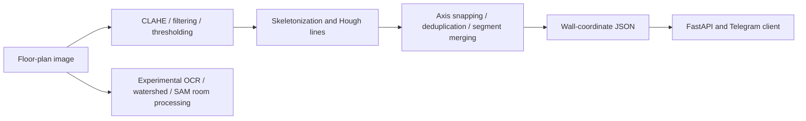

# Floor Plan Recognition

**Extract wall geometry from raster floor plans and expose it through a FastAPI service and a Telegram interface.**

This project turns scanned or photographed architectural drawings into editable
wall segments. It combines an inspectable OpenCV pipeline with experimental
OCR-assisted and pretrained-model segmentation components.

## Engineering focus

- Image preprocessing, line detection and geometric post-processing are separate stages.
- Classical wall extraction can be inspected without training a task-specific model.
- A shared recognition service supports both HTTP uploads and a Telegram client.
- OCR/watershed and SAM experiments explore room boundaries without conflating them with the current public response contract.

## Implemented pipeline



The implementation uses OpenCV, scikit-image, FastAPI, EasyOCR and an optional
SAM 2.1 model loaded through Ultralytics. These are third-party components; this
repository supplies the application pipeline and integration around them.

## Processing details

The wall path is deliberately inspectable, with its parameters visible in
[hybrid_service.py](services/hybrid_service.py):

| Stage | Current implementation |
|---|---|
| Local contrast | CLAHE, `clipLimit=3.0`, `tileGridSize=(8, 8)` |
| Edge-preserving smoothing | Bilateral filter, `d=9`, `sigmaColor=75`, `sigmaSpace=75` |
| Binarization | Intersection of Otsu and adaptive Gaussian thresholding; adaptive block size 21, C=10 |
| Morphology | 3×3 rectangular kernel; closing then opening |
| Wall candidates | Skeletonization and `HoughLinesP`; threshold 30, minimum line 20 px, maximum gap 35 px |
| Geometry cleanup | Axis snapping, duplicate removal and collinear merging with 3°/50 px thresholds |

Room experiments use numeric OCR labels as watershed seeds, then supplement sparse
results with SAM candidates. A recognized area label is source text, not automatic
pixel-to-metre calibration. These choices make both the useful assumptions and
their failure cases visible.

## Current API contract

| Service | Port | Endpoint | Purpose |
|---|---:|---|---|
| Hybrid recognition | 8003 | `POST /detect` | Upload an image using multipart field `file`; receive `meta` and `walls` |
| Hybrid recognition | 8003 | `GET /health` | Process status and whether the SAM model loaded |
| Cleanup | 8001 | `/clean` | Image preprocessing |
| OCR | 8002 | `/ocr` | Text recognition |

**Room processing is experimental:** `process_image()` calculates candidate
rooms internally, but the current `/detect` response returns `meta` and `walls`.
It does not currently export those room polygons. Coordinates are in pixels;
physical scale and CAD reconstruction are not established by this API.

The following illustrates the current response shape; coordinates are an example,
not a measured recognition result:

```json
{
  "meta": {"source": "plan.png"},
  "walls": [
    {"id": "w1", "points": [[100, 200], [500, 200]]},
    {"id": "w2", "points": [[500, 200], [500, 600]]}
  ]
}
```

## Run the service

Docker and Docker Compose are required for the container workflow. Recognition
models may require an initial download and their own runtime dependencies.

```bash
git clone https://github.com/Maxi-online/floor-plan-recognition.git
cd floor-plan-recognition
docker compose up --build -d
curl http://localhost:8003/health
```

The Compose file starts the application services in **one container** and exposes
the three ports. It mounts `settings_secret.json` and persists model caches.
Configure that local JSON file before using the Telegram interface:

- `telegram_bot_token`: the bot credential issued by Telegram;
- `hybrid_url`: `http://localhost:8003/detect` for the supplied single-container setup.

Keep personal credentials out of published configuration. An HTTP health response
with `sam2_large: false` means the optional model is unavailable; it is not an
accuracy measurement. The generated upload interface is at
`http://localhost:8003/docs`.

For the existing platform-specific instructions, see [QUICKSTART.md](QUICKSTART.md)
and [DOCKER.md](DOCKER.md). Source entry points are
[hybrid_service.py](services/hybrid_service.py),
[tg_bot.py](tg_bot.py) and [settings.py](settings.py).

## Local service development

Create a virtual environment and install [requirements.txt](requirements.txt).
With that environment active, use separate terminals for the three services:

```bash
python -m uvicorn services.hybrid_service:app --port 8003
python -m uvicorn services.ocr_service:app --port 8002
python -m uvicorn services.cleanup_service:app --port 8001
```

After configuring `settings_secret.json`, start the Telegram client in another
terminal with `python tg_bot.py`. It accepts a plan image and returns the
recognition result/visualization. Model availability can be checked through
`GET /health`; HTTP upload testing is available through `/docs`.

## Design trade-offs and validation

Hough-based walls are explainable and inexpensive relative to a learned detector,
but text, furniture and hatching can produce false positives. Axis snapping and
segment merging can distort oblique or closely spaced geometry. Room experiments
depend on legible labels and segmentation behaviour.

The repository does not include a reproducible labelled benchmark establishing
wall/room accuracy or processing-time guarantees. Useful next measurements are
wall precision/recall, room IoU, connectivity errors and latency on a versioned
set of drawings. Fine-tuning, door/window recognition, scale calibration and CAD
export remain possible extensions rather than delivered capabilities.

## Author and citation

Maksim Strekolovsky (Maxi-online), as credited in the original project documentation.

```bibtex
@software{floor_plan_recognition,
  title = {Floor Plan Recognition Service},
  author = {Strekolovsky, Maksim},
  year = {2025},
  url = {https://github.com/Maxi-online/floor-plan-recognition}
}
```

## Project status, license and attribution

Research/application prototype, provided as-is for research and development as
stated in the original project documentation. OpenCV, EasyOCR, Ultralytics and SAM
retain their own licenses and attribution.

## Конфигурация, приватность и воспроизведение

Скопируйте `settings_secret.example.json` в игнорируемый `settings_secret.json` и задайте только собственные значения. Этот файл используется локально; перед публикацией изображений удалите адреса, подписи владельцев и другую персональную информацию. JSON-ответ `/process_hybrid` содержит `meta` и `walls`; вычисление комнат внутри pipeline не гарантирует их наличие в ответе.

Секреты храните в игнорируемых локальных файлах или переменных окружения. Безопасные примеры содержат только структуру настройки. Не передавайте секреты в командной строке и не добавляйте заполненные `.env`, приватные ключи, базы данных и логи в коммиты.

Workflow [Secret scan](.github/workflows/secret-scan.yml) проверяет текущие файлы и входящие коммиты Gitleaks 8.30.1 с редактированием значений в выводе. Это проверка на известные шаблоны, а не подтверждение отсутствия всех возможных утечек. Удаление значения из HEAD не очищает старую историю; порядок действий описан в [SECURITY.md](SECURITY.md).
